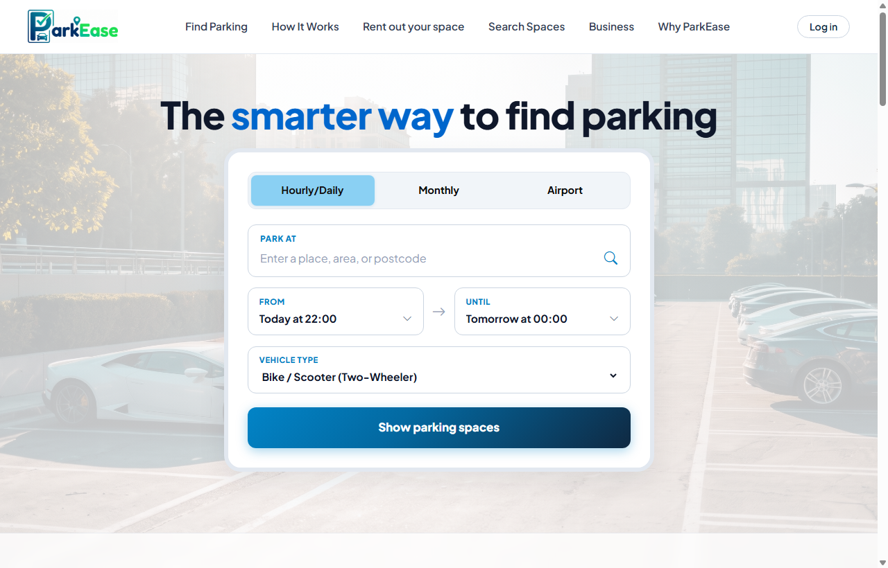
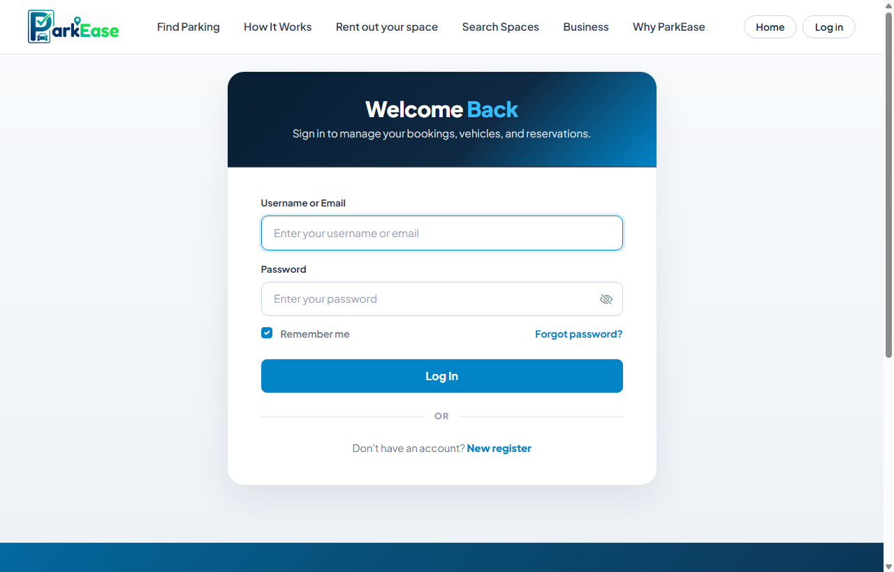
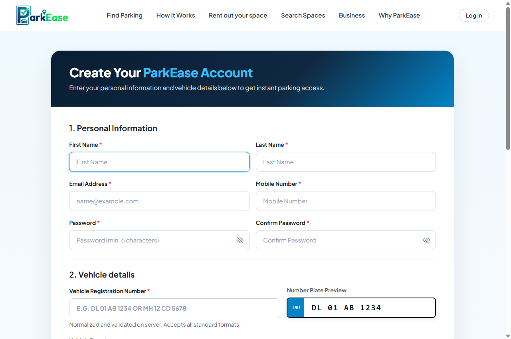
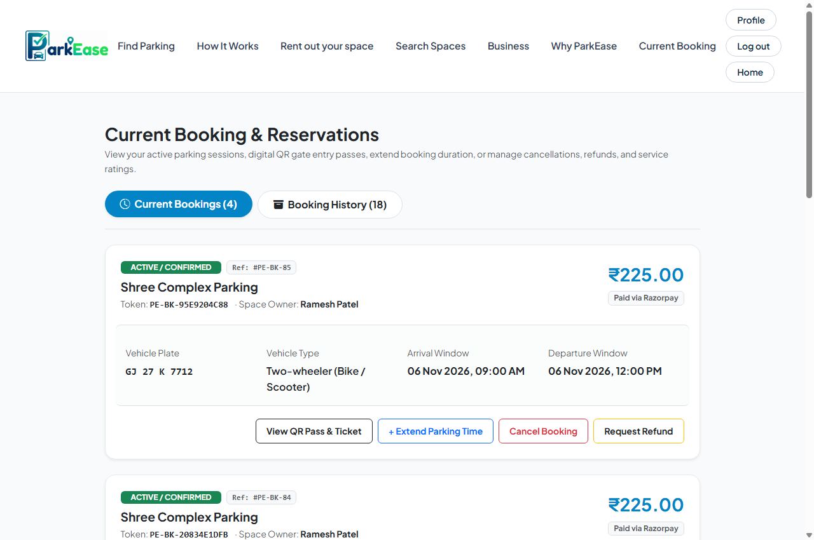
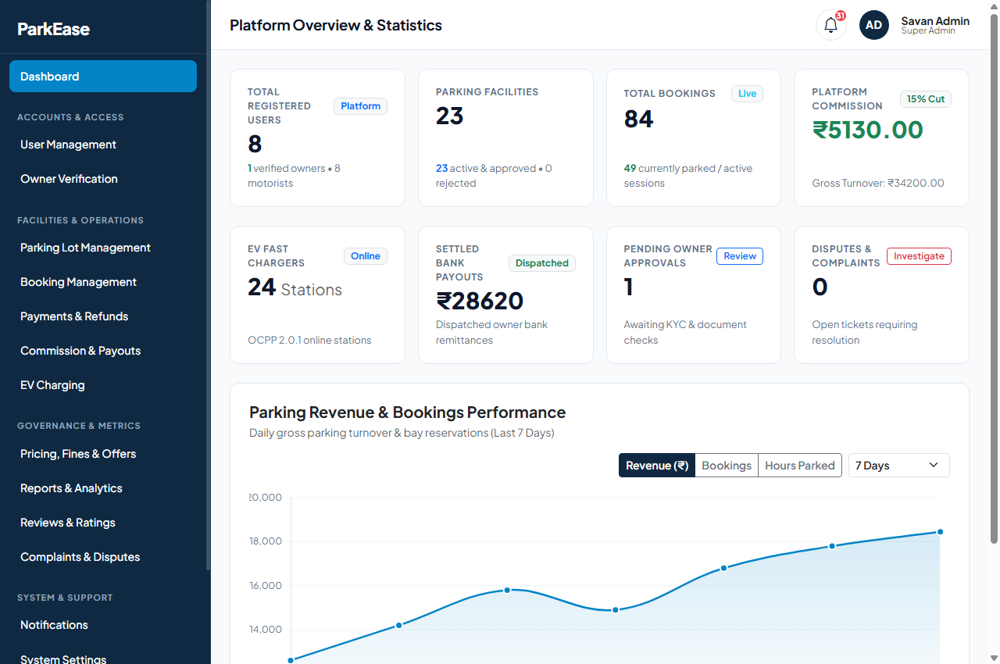
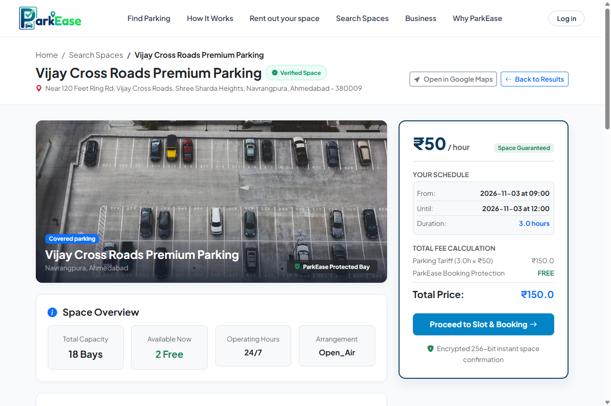
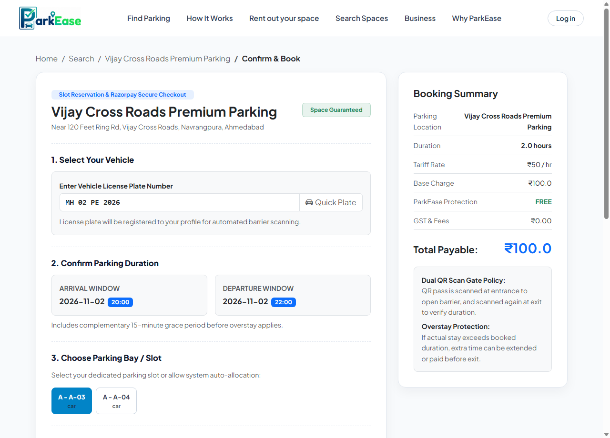
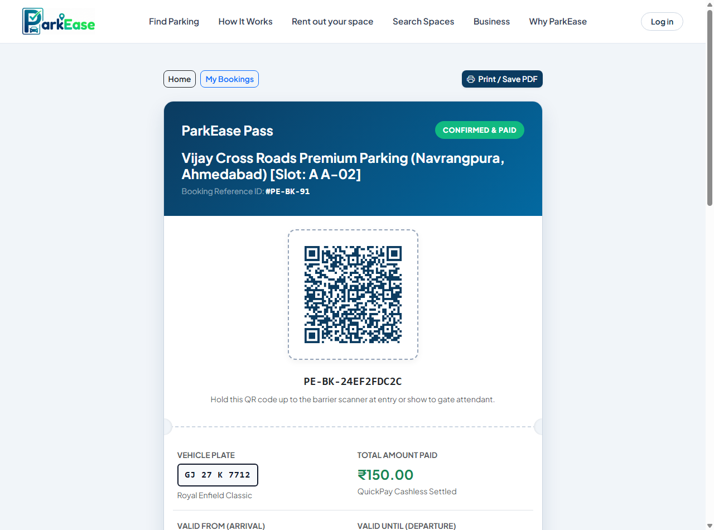

# ParkEase — Smart Urban Parking & Bay Reservation Platform

> A full-stack, enterprise-grade smart parking management ecosystem that seamlessly connects motorists, parking lot owners, and platform administrators. Built with Python and Django, it features interactive map discovery, guaranteed bay reservations, contactless dual QR entry/exit passes, automated overstay clearance, and official Razorpay payments.

---

## Project Overview

Urban drivers often waste substantial time, fuel, and effort circling congested city blocks searching for available parking. Simultaneously, commercial lots, private driveways, and parking facilities frequently operate with idle, unmonetized capacity due to a lack of real-time digital visibility.

**ParkEase** bridges this gap by delivering an end-to-end, high-trust urban mobility solution inspired by modern European parking ecosystems (such as JustPark):

* **For Motorists (Drivers):** Provides a clean, frictionless booking journey to search for nearby parking facilities, compare real-time hourly rates, reserve guaranteed bays in advance, navigate via turn-by-turn maps, and enter/exit using live scannable QR passes.
* **For Parking Space Owners:** Offers a dedicated Space Owner Studio to list parking facilities, configure flexible vehicle-specific tariffs, monitor visual slot occupancy in real time, review duration extension requests, and track daily revenue.
* **For Platform Administrators:** Features a centralized Administrative Studio to oversee platform-wide metrics, enforce pricing and overstay penalty policies, manage promotional coupons, handle disputes, and audit email delivery logs.

The platform is engineered using Django's Model-View-Template (MVT) architecture with strict role-based access control (RBAC), database normalization, asynchronous email notifications, and an official Razorpay payment gateway integration.

---

## Key Features

### 1. Motorist & Driver Experience
* **Smart Facility Search & Geo-Discovery:** Locate available parking spots by city, neighborhood, airport, or landmark with real-time distance calculations and interactive maps.
* **Guaranteed Bay Reservation:** Reserve parking ahead of arrival with customized vehicle category rates (Two-Wheeler, Hatchback/Sedan, SUV, EV).
* **Dual QR Scan Gate Policy:** Generates cryptographically verifiable, scannable digital QR passes that are verified at both entrance and exit boom barriers.
* **Automated Overstay Detection:** Built-in monitoring that detects parking sessions exceeding the booked window, automatically calculates penalty fees based on admin grace periods, and allows 1-click clearance.
* **Digital Garage & Vehicle Management:** Add and manage multiple vehicle registration plates with automatic ANPR format normalization.
* **Digital Pass & Directions:** Instant access to digital parking tickets with 1-click turn-by-turn Google Maps navigation and print/PDF download capabilities.
* **My Bookings Dashboard:** Filter between active upcoming reservations and past booking history with cancellation and refund triggers.

### 2. Space Owner Management Suite
* **Facility Onboarding & Multi-Tariff Setup:** Multi-step wizard to register parking lots, set base hourly tariffs, define vehicle-specific pricing, and highlight amenities (CCTV, Covered, 24/7 Security, EV charging).
* **Visual Bay & Slot Grid:** Real-time visual matrix displaying the live status of every parking bay (Available, Reserved, Occupied, Maintenance).
* **Duration Extension Handling:** Motorists can request time extensions; owners can review requests, detect subsequent schedule conflicts, and approve or reassign bays.
* **Financial Insights & Settlement Hub:** Live dashboards tracking gross turnover, platform commission deductions, and net payouts.
* **Customer Reviews & Ratings:** Monitor driver feedback and average star ratings for each facility.

### 3. Platform Administration Studio
* **Executive KPI Dashboard:** Real-time metrics for total revenue, active bookings, overall slot occupancy, open disputes, and driver registrations.
* **Revenue & Performance Charts:** Interactive multi-metric analytical charts (Revenue, Bookings Count, Hours Parked) toggleable by time period (7 Days, 30 Days, Last Quarter, 1 Year).
* **Global Pricing & Overstay Policy:** Configure platform maximum hourly rate caps, grace period windows (minutes), and overstay fine multipliers.
* **Promotional Discount & Coupon Engine:** Create, publish, activate, or disable promotional discount codes with custom percentage discounts and maximum deduction caps.
* **Payment & Refund Reconciliation:** Full financial audit trail with transaction logs and instant refund mechanisms.
* **Automated Email Notification System:** Built-in HTML email dispatcher for booking confirmations, password resets, and admin alerts, complete with a delivery audit log.

### 4. Official Razorpay Payment Gateway Integration
* **Official Razorpay Checkout SDK:** Integrated directly with Razorpay's client-side library (`checkout.js`) without simulated or third-party wrappers.
* **Multi-Method Support:** Accepts Credit Cards, Debit Cards (Visa, MasterCard, RuPay, Maestro), Netbanking across 30+ Indian banks, and digital wallets.
* **Demo / Test Sandbox Ready:** Fully testable using test card credentials (`4111 1111 1111 1111`) and test bank simulation with zero SMS wait times.
* **Asynchronous Post-Payment Flow:** Triggers asynchronous email dispatching upon confirmation and instantly redirects the motorist to their generated QR pass (< 0.1s latency).

---

## Technology Stack

### Backend & Core Architecture
* **Python (3.10+ / 3.11 / 3.12)** 
* **Django (5.0+)**
* **Django Templates (DTL)**

### Frontend, Styling & UI
* **HTML5 & CSS3** 
* **Bootstrap 5.3** 
* **Vanilla JavaScript (ES6+)** 

### Mapping, GIS & Routing
* **Leaflet.js (v1.9.4)**
* **MapLibre GL**
* **OpenFreeMap Liberty**
* **OSRM (Open Source Routing Machine)**

### Payment Gateway
* **Razorpay Official Checkout SDK (`https://checkout.razorpay.com/v1/checkout.js`)**
* **Razorpay Python SDK (`razorpay`)**

### Media, QR Code & File Processing
* **Python `qrcode` Library**
* **Pillow (PIL)**

### Database & Environment Management
* **SQLite3**
* **Django ORM**
* **`python-dotenv`**


---

## Project Screenshots

### 1. Homepage & Smart Facility Discovery



---

### 2. Authentication (Login & Registration)

| Motorist Login | New Account Registration |
| :---: | :---: |
|  |  |

---

### 3. User Dashboard (My Bookings)



---

### 4. Admin Dashboard (Platform Governance Studio)



---

### 5. Main Functionalities

#### A. Parking Facility Details & Interactive Map Navigation



#### B. Booking Checkout & Official Razorpay Gateway



#### C. Digital Parking Ticket with Scannable QR Pass



---

## Project Credentials (All 3 Portals)

The application provides pre-configured role accounts for testing and evaluation across all three platform workflows:

| Role | Username / Email | Password | Access Portal URL |
| :--- | :--- | :--- | :--- |
| **Motorist / Driver** | `user@gmail.com` | `user123` | [`http://127.0.0.1:8000/accounts/login/`](http://127.0.0.1:8000/accounts/login/) |
| **Space Owner** | `owner@gmail.com` | `owner123` | [`http://127.0.0.1:8000/accounts/login/`](http://127.0.0.1:8000/accounts/login/) |
| **Super Administrator** | `admin` | `admin123` | [`http://127.0.0.1:8000/admin-panel/login/`](http://127.0.0.1:8000/admin-panel/login/) |

---

## Installation & Setup Guide

### Windows

```bash
# 1. Clone the repository
git clone https://github.com/brainybeamGit/ParkEase-Django-P1.git
cd ParkEase-Django-P1

# 2. Create and activate virtual environment
python -m venv venv
venv\Scripts\activate

# 3. Install dependencies
pip install -r requirements.txt

# 4. Run database migrations
python manage.py migrate

# 5. Create a superuser (admin account)
python manage.py createsuperuser

# 6. Seed initial data (optional)
python scripts/seeds.py

# 7. Start the development server
python manage.py runserver
```

Open `http://127.0.0.1:8000` in your browser.

---

### macOS / Linux

```bash
# 1. Clone the repository
git clone https://github.com/brainybeamGit/ParkEase-Django-P1.git
cd ParkEase-Django-P1

# 2. Create and activate virtual environment
python3 -m venv venv
source venv/bin/activate

# 3. Install dependencies
pip install -r requirements.txt

# 4. Run database migrations
python3 manage.py migrate

# 5. Create a superuser (admin account)
python3 manage.py createsuperuser

# 6. Seed initial data (optional)
python3 scripts/seeds.py

# 7. Start the development server
python3 manage.py runserver
```

Open `http://127.0.0.1:8000` in your browser.

---

##  Project Architecture & Skeleton

```text
ParkEase/
├── accounts/                     # User management & motorist garage
│   ├── migrations/               # Database schema versions
│   ├── models.py                 # Custom Profile, Vehicle, EmailDeliveryLog models
│   ├── views.py                  # Driver login, register, profile, garage views
│   └── urls.py                   # Motorist authentication routing
│
├── admin_panel/                  # Super Administrator Management Studio
│   ├── models.py                 # PlatformPricingRule, Coupon, PlatformComplaint models
│   ├── views.py                  # Revenue analytics, payout approvals, pricing controls
│   └── urls.py                   # Admin endpoints (/admin-panel/*)
│
├── lot_owner_panel/              # Space Owner Management Suite
│   ├── models.py                 # ParkingLot, ParkingSlot, OwnerNotification models
│   ├── views.py                  # Facility listing, bay occupancy matrix, earnings
│   └── urls.py                   # Space owner routing (/lot-owner/*)
│
├── parking/                      # Core search, booking & ticketing engine
│   ├── models.py                 # Booking, OverstayRecord, LotReview models
│   ├── views.py                  # Search, bay reservation, ticket, QR scanner, overstay
│   └── urls.py                   # Booking lifecycle endpoints
│
├── parkease/                     # Project configuration & background services
│   ├── email_service.py          # Asynchronous SMTP notification dispatcher
│   ├── settings.py               # Django configuration & gateway settings
│   ├── urls.py                   # Master URL routing table
│   └── wsgi.py                   # Production WSGI application
│
├── scripts/                      # Management & database automation
│   └── seeds.py                  # Database seeder (creates default users & demo lots)
│
├── docs/                         # Documentation & assets
│   └── screenshots/              # High-resolution platform visual previews
│
├── static/                       # Static stylesheets, brand media & scripts
│   ├── css/style.css             # Main unified stylesheet (responsive & cleaned)
│   ├── js/                       # Client-side JavaScript helpers
│   └── images/                   # Official platform logos and markers
│
├── templates/                    # Cleaned, responsive HTML templates
│   ├── accounts/                 # Driver login, register, profile
│   ├── admin_panel/              # Admin dashboard, pricing, payments, complaints
│   ├── lot_owner_panel/          # Owner dashboard, slots, earnings, extensions
│   ├── parking/                  # Home search, lot detail, booking, ticket pass
│   └── base.html                 # Unified master layout
│
├── .env.example                  # Environment credentials template
├── .gitignore                    # Production Git ignore rules
├── LICENSE                       # MIT Open-Source License
├── manage.py                     # Django CLI management executable
├── README.md                     # Comprehensive project documentation
└── requirements.txt              # Pinned Python package dependencies
```

## 🛡️ License

This project is licensed under the [MIT License](LICENSE).
